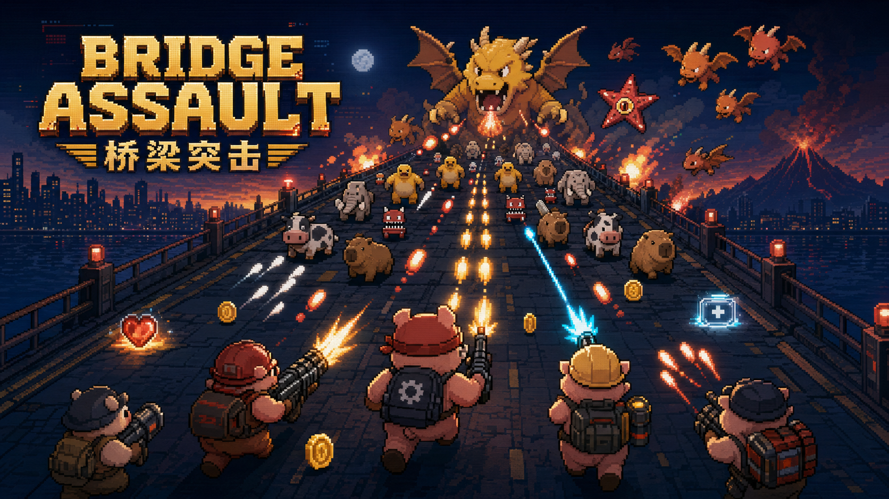

# Bridge Assault

布里斯托大学 COMSM0166 第 25 组作品。Bridge Assault 是一款用 p5.js 制作的双语像素生存射击游戏。玩家在自动推进的战场上左右移动，穿越增益门，应对不同敌人波次，并使用关内外升级挑战两个关卡。

**我的角色**是小组设计师。原项目报告记录的贡献包括游戏概念、视觉方向、界面反馈、玩家体验及项目文档。

- [在线试玩](https://uob-comsm0166.github.io/2026-group-25/)
- [演示视频](https://www.youtube.com/watch?v=91fSc7DAjAI)
- [小组原仓库与项目报告](https://github.com/UoB-COMSM0166/2026-group-25)
- [下载源码、演示视频及本地项目资料](https://github.com/gearsofwarhao-0703/game-design-portfolio/releases/download/portfolio-v1/bridge-assault.zip)

本页沿用小组原项目的版权与许可。 [COMSM0166 Group 25 MIT License](LICENSE)
