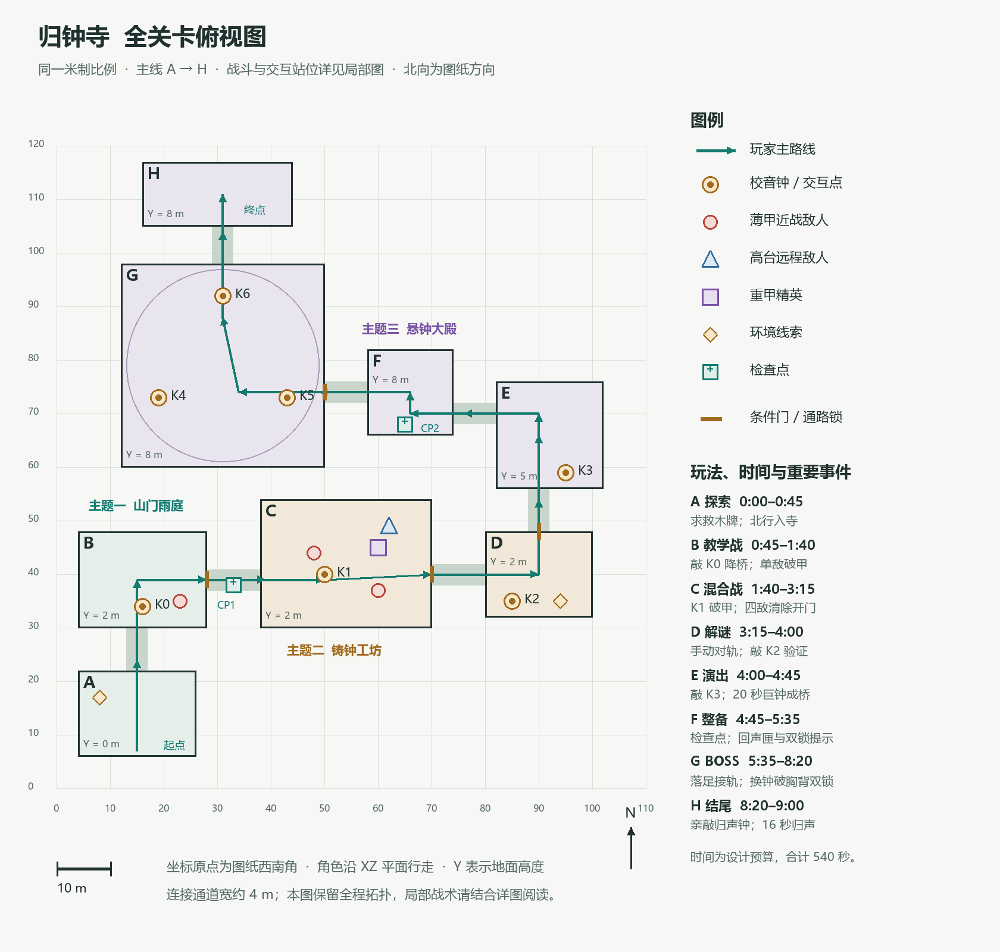
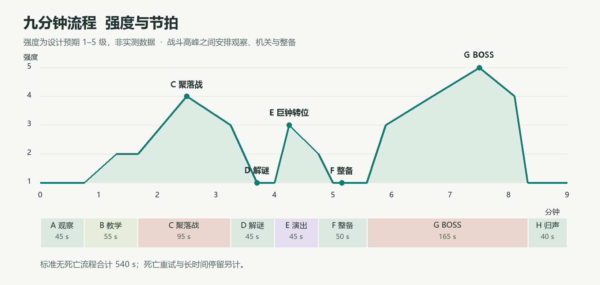
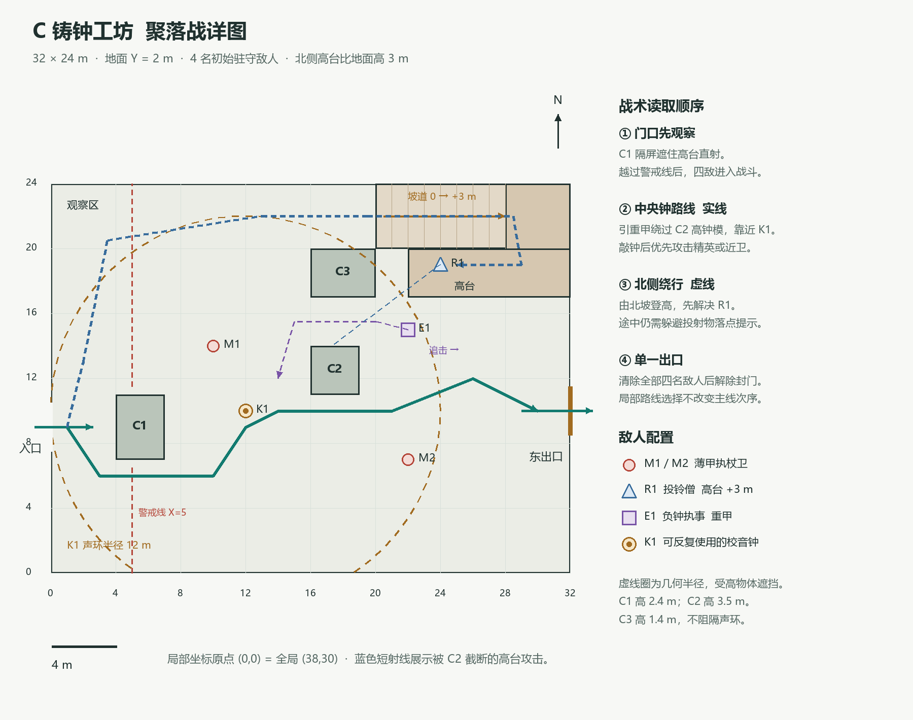
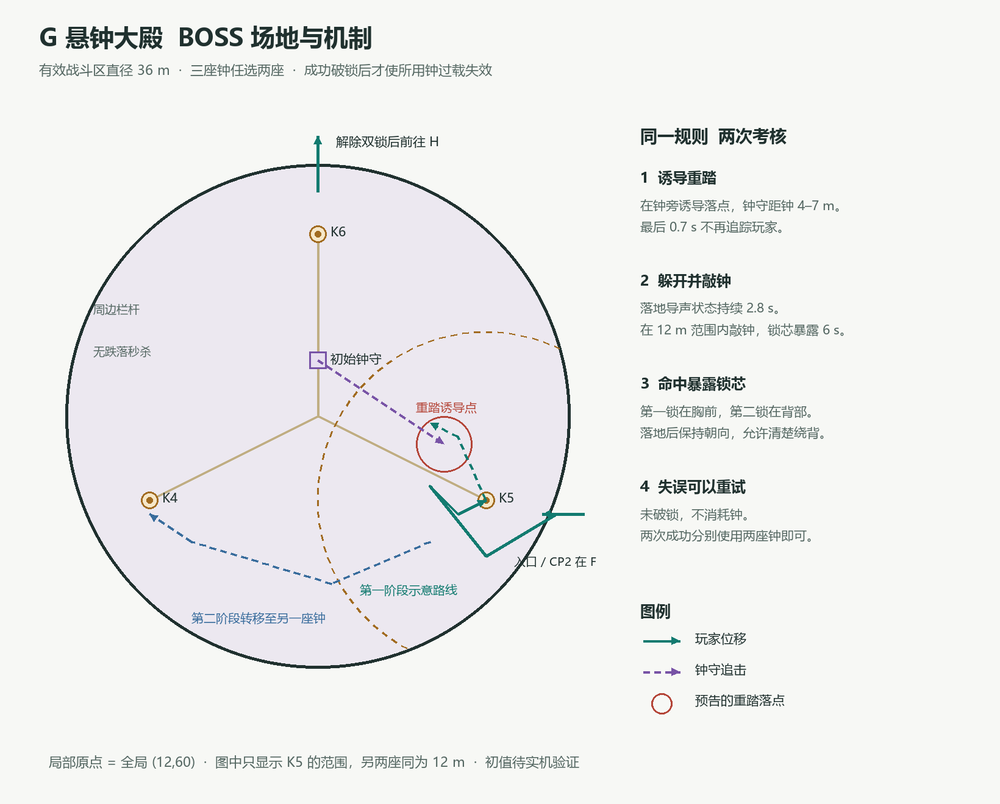

# 归钟寺 最后一响

第三人称动作冒险线性关卡设计方案 · 目标时长 8–10 分钟 · 提交版 0.6.1 · 文档与当前实现同步

玩家扮演一名回声修补匠，进入因故障而封闭的归钟寺，在下一次镇声仪式启动前，释放被寺庙扣留的村民声音。关卡以“敲钟令听石共振”为统一规则，将道路开启、战斗破甲、空间演出和 BOSS 弱点串联起来。标准流程设计预算为 9 分钟。用户已于 2026-09-22 真人试玩并确认导入美术前版本首玩符合 8–10 分钟要求，未提供精确秒数。0.5–0.6.1 沿用既有路线、数值和过场时长；本次没有新增真人计时样本。

## 1 设计目标与范围

- 玩家能够看懂目标，沿单一主线推进；重点战斗场地提供短距离绕行选择，出口保持唯一。
- 通过一次安全示范、一次低压练习、一次混合敌人遭遇、一次 BOSS 考核，完成核心机制的教学与检验。
- 以山门雨庭、铸钟工坊、悬钟大殿三个场景主题形成空间变化，全部属于同一寺庙建筑体系。
- 以“崖底巨钟转位，铺出通向大殿的道路”为 WOW 时刻，让已经见过的地标改变意义。
- 优先验证通路、视线、战斗站位、镜头和节奏；美术与复杂战斗系统留到空间验证之后。

本方案交付全流程、节拍表、全局俯视图、重点遭遇详图、BOSS 机制与平面图、当前程序的 20 镜故事板，以及技术概览和验收说明。完整 Demo、Unity 工程、20 页 PPT 与预览视频随本包提供。

## 2 世界观与故事

**寺庙的职责。** 山谷中的“听石”会储存声音。归钟寺定时敲响巨钟，让积存在山体中的声音有序释放，避免山谷因共振崩塌。僧人去世后留下的仪式记录仍由听石机关执行。

**事故。** 地震切断了释放声音的导声轨。失去反馈的钟守误把村民的呼救识别为噪声，持续收集而拒绝释放；它并非被邪恶力量附身，而是在机械地履行过期的镇声规则。

**玩家。** 回声修补匠带着师父留下的共鸣槌前来修复。槌只能击响有铜环的校音钟，不能随处施放能力，因此玩家必须借助场地、判断距离并创造敲钟时机。

**三段叙事。** 山门看见失声者留下的求救字句，建立救援动机；工坊发现导声轨折断与僧人的维修记录，理解事故；大殿解除钟守的两个镇声锁，将镇声程序切换为归声程序，听到村民的声音回到山谷。

**结尾落点。** 没有额外反转或新任务。玩家亲手敲响归声钟，先听见一声呼唤，随后风铃与雨声重新进入声场，完成救援闭环。

## 3 玩家能力与统一机制

基础操作假设为移动、镜头、轻攻击、闪避、交互。主线使用坡道与楼梯，不要求跳跃、攀爬或精确平台操作。普通攻击处理近战敌人，闪避处理清楚预告的攻击，交互用于钟、绞盘和结尾机关。

| 项目 | 规则初值 | 玩家如何辨认 |
| --- | --- | --- |
| 校音钟 K | 接近 1.8 m 后交互；挥槌动作 0.7 s，第 0.4 s 发出声环；冷却 8 s | 铜环轮廓、悬挂槌、可见地面环纹；冷却以铜色恢复及倒计时提示 |
| 声环 | 半径 12 m；持续 0.5 s；只影响同一战斗空间内、没有实心高墙遮挡的听石目标 | 地面扩散的环纹，同时播放一次清楚钟声；不能只靠声音识别 |
| 护甲破除 | 范围内听石护甲暂时失效 6 s；普通薄甲卫兵也可绕背击败，避免唯一解 | 轮廓变为青色，掉落碎屑并短暂后仰 |
| 固定机关 | 钟声沿可见铜轨传导至指定机关，触发预设的一次性移动；不要求机关处于 12 m 范围内 | 铜轨依次亮起，终点机关开始运动；已完成机关不会反向关闭 |
| 受击打断 | 敲钟生效前受击则取消，本次不进入冷却；生效后受击不撤销声环 | 玩家受击反馈与钟环状态保持一致 |

**规则边界。** 普通护甲只减伤，不造成完全无解；BOSS 的镇声锁需要其重踏后的“导声脚”落地才能响应钟声，这一连接状态用脚下铜纹直接呈现。墙体、高钟模和隔屏阻隔声环，低矮经案不阻隔。门外的敌人不会隔墙被激活。

**教学顺序。** B 区安全敲钟，先看到桥降下；随后一名薄甲守卫走入桥头，钟冷却完成后玩家可再次敲钟破甲，也可通过绕背解决。C 区将同一规则放入远程压制和重甲追击中，G 区再增加 BOSS 的导声落地时机。

## 4 全流程与节拍表

图中北向为图纸方向。所有区域与连接通道按同一米制比例布置；高差用标高表达。全局图用于拓扑与动线，C、G 的战斗摆位以各自详图为准。

| 区域与时间 | 区域目标 | 玩家行动与核心玩法 | 环境线索和脚本事件 | 强度 1–5 |
| --- | --- | --- | --- | --- |
| A 山门雨庭 0:00–0:45 | 确认寺庙入口和救援目标 | 沿石阶前进，阅读求救木牌；无敌人 | 山门灯笼框住前路；木牌交代求救；门柱写着“把声音还给我们” | 1 |
| B 校音回廊 0:45–1:40 | 学会敲钟开路与破甲 | 安全敲 K0，踏过降桥；对付 1 名薄甲守卫 | 铜轨先亮后桥降；守卫跨过环纹进入声环可及范围 | 2 |
| C 铸钟工坊 1:40–3:15 | 解除工坊封门声场 | 观察站位，选择中心敲钟或北侧绕行；击败 4 名敌人 | 经案遮住部分射线；高台投铃僧压制中央；四敌清除后出口封印熄灭 | 4 |
| D 冷却水院 3:15–4:00 | 修复导声轨，理解事故 | 无战斗；转动绞盘对齐唯一缺口，再敲 K2 验证 | 错位铜轨、对接标记与绞盘指向修复关系；录声牌提供一句事故信息 | 1 |
| E 悬钟井 4:00–4:45 | 见证修复效果并取得上行道路 | 走入稳定观景台，敲 K3；看巨钟转位、钟架展开，再通过坡道 | 20 s 演出；远处钟守被唤醒；恢复控制时新出口位于前方亮处 | 3 |
| F 静音前室 4:45–5:35 | 补给并读懂 BOSS 空间 | 自动补满基础生命，阅读落足接轨提示；走向殿门 | 浮雕显示“落足接轨—敲钟开锁”；三座小钟可从窗口辨认；记录 CP2 | 1 |
| G 悬钟大殿 5:35–8:20 | 解除钟守两个镇声锁 | 诱导重踏、敲邻近钟、攻击暴露锁芯；两阶段机制战 | 第一锁破除后已用钟失效，需转移至另外两座钟之一；成功后中央归声装置开启 | 5 |
| H 归声台 8:20–9:00 | 释放被扣留的声音 | 沿钟守让出的北向通路登台，交互敲响归声钟 | 声音从单个人声扩展至整个山谷；显示完成，结束本关 | 1 |

**时长核算。** 45 + 55 + 95 + 45 + 45 + 50 + 165 + 40 = 540 秒。含必要观察与交互，不含死亡重试、暂停和长时间驻足。8–10 分钟已获用户此前真人首玩确认；540 秒仍是设计预算，不是测得秒数。C、G 是主要可调节时长区，优先调敌人压制与失败恢复，不靠拉长走廊凑时间。

**节奏控制。** C 的混合压力之后，D 只保留一个可读解谜；E 用空间变化提高情绪而不追加敌人；F 提供完整整备窗口，G 再进入全关最高压力。A、D、H 分别承载目标、真相、结果，剧情信息不叠加到高压战斗中。

## 5 全局空间与指引

米制坐标以全局图西南角为原点，X 向东、Z 向北，Y 为高度；矩形尺寸不包含相邻过道。

| 区域 | X 范围 m | Z 范围 m | 地面标高 Y m | 主体尺度与通路 |
| --- | --- | --- | --- | --- |
| A | 4–26 | 6–22 | 0 | 22 × 16 m；向北通过 4 m 宽缓坡接 B |
| B | 4–28 | 30–48 | 2 | 24 × 18 m；降桥宽 3 m；向东经 4 m 宽过道接 C |
| C | 38–70 | 30–54 | 2；高台 5 | 32 × 24 m；两条局部进攻路线汇合于东侧单一出口 |
| D | 80–100 | 32–48 | 2 | 20 × 16 m；浅水不减速；向北通过缓坡接 E |
| E | 82–102 | 56–76 | 5 | 20 × 20 m；稳定观景台与机械运动区域分离 |
| F | 58–74 | 66–82 | 8 | 16 × 16 m；E 至 F 的展开通路包含约 12 m 长缓坡 |
| G | 12–50 | 60–98 | 8 | 38 × 38 m 包络；圆形有效战斗区直径 36 m |
| H | 16–44 | 105–117 | 8 | 28 × 12 m；与 G 之间连接宽 4 m |

**镜头尺度。** 以角色高 1.8 m、镜头后距约 4.5 m、高约 2.4 m、垂直视角约 55° 作为起测值。普通通道净宽不少于 3 m，主通道约 4 m，门高不少于 3.2 m。低经案高 1.2–1.5 m，负责切分走位；对付高台射线的隔屏和钟模分别高 2.4 m 与 3.5 m。高掩体集中布置，不遮住整面出口；天花与横梁留出镜头回退空间。

**指引层级。** 远处巨钟负责方向记忆；中距离以门洞、导声铜轨和较亮地面衔接下一区；近距离交互靠铜环轮廓与姿态辨认。未开放路线使用实体断口或关闭的封门，不摆放形似可走道路的无效入口。

**防止迷路。** A 首次出现巨钟，E 再让同一地标转位；C 的高台绕行不超过半个房间，始终能回看中央钟；G 三座钟轮廓一致，状态以完整铜环、冷却环、破损环区分。环境说明牌可略过，不承担唯一通关信息。

## 6 重点片段 铸钟工坊聚落战

**设计问题。** 玩家已经知道敲钟有用，但不能站在钟旁连续无风险攻击。用远程射线逼迫移动，用两名近战卫兵让中心路线有压力，再用重甲敌人提供把敌人引入声环的明确收益。

**空间。** 局部原点位于 C 区西南角，对应全局 (38,30)。场地 32 × 24 m，西入口 (0,9)，东出口 (32,10)。入口观测袋长约 4 m，在跨过 X=5 的警戒线之前敌人不主动攻击；玩家可先看到钟、高台与重甲守卫。

| 编号 | 对象与数量 | 局部初始坐标 X Z m | 行为与功能 |
| --- | --- | --- | --- |
| K1 | 校音钟 1 | (12,10)，地面 | 半径 12 m；E1 初始距钟约 11.2 m，但受 C2 遮挡，需引它绕出；可从南侧贴近交互 |
| M1 | 薄甲执杖卫 1 | (10,14) | 初始驻守北侧经案附近；遭遇激活后追击，提供敲钟破甲收益 |
| M2 | 薄甲执杖卫 1 | (22,7) | 看守东侧通路；在战斗触发后从南面靠近，阻止单一路线站桩 |
| R1 | 投铃僧 1 | (24,19)，相对高 +3 m | 固定高台射击，约每 4 s 一次；抬手和落点圈预告 0.9 s，不能穿经案攻击 |
| E1 | 负钟执事 1 | (22,15) | 重甲精英，慢速追击；约 1.15 s 前摇后进行近身重击，攻击后恢复；当前未实现位移冲撞 |
| C1 | 入口隔屏 | X=4–7，Z=7–11，高 2.4 m | 遮住 R1 对入口近处的射线，保护观察和首次移动 |
| C2 | 中央高钟模 | X=16–19，Z=11–14，高 3.5 m | 截断高台至 K1 的斜射线，同时挡住 K1 至 E1 初始位置的声环，要求诱敌绕出 |
| C3 | 北部经案 | X=16–20，Z=17–20，高 1.4 m | 划分北侧路线，不完全遮挡高台射击；低矮结构不阻隔钟声 |
| RAMP | 北侧坡道 | X=20–28.2，Z=20–24 | 约 8.2 m 长、4 m 宽；由西向东升到 +3 m，末端接宽转角平台；全程可步行 |
| LANDING | 高台转角 | X=28–32，Z=19–24 | 顶部标高 +3 m；与坡道略作重叠，向南接 X=22–32、Z=17–20 的远程高台 |

**路线一 先用中央钟。** 入口停看约 8 s → 利用 C1 接近 K1 → 往钟南侧退，引 M1 和 E1 绕出 C2 → 借助 C2 遮住高台至钟旁的射线，抓住近战敌人恢复时敲钟 → 优先打 E1 或最近的薄甲敌人 → 绕 C2 清理剩余近战 → 通过北坡处理 R1 → 从东出口离开。声环范围内仍被高钟模挡住的敌人不会破甲。路线允许玩家选择击杀顺序，不要求精确站在一个像素位置。

**路线二 先解除高台压制。** 从 C1 向北沿西墙绕行，通过 C3 北侧进入北坡 → 登高击败 R1 → 顺原坡回到地面 → 把近战敌人带回 K1 声环 → 处理 E1 → 出口。这条路线暴露时间较长，需要边走边读落点提示；收益是提前消除远程压制。北坡为战术绕行，不是第二条关卡主线。高台边缘设置栏杆，不能通过跳落直接绕过封门。

**战斗调度。** 四名敌人均为初始驻守，不凭空刷第二波。跨警戒线后统一警戒；最多两名近战同时持有攻击令牌，其余追击接近并等待攻击名额。远程固定驻守高台，射线被挡则等待，不隔墙发起射击。E1 不上窄坡，守在坡口但不能堵死整个 4 m 通道；薄甲卫兵可追上坡。敌人不能通过未打开的出口离场。

**灰盒空间修订。** 实机走图发现原坡道末端的高差与连续护栏会妨碍转入高台，因此将上坡段收短至约 8.2 m，东端补为 4 m 宽转角；敌人站位和主线不变。前室至大殿的连接地板与两端略作重叠，以消除导航接缝。

**95 秒预算。** 观察与选路约 10 s、首次交锋约 15 s、钟与重甲循环约 35 s、处理远程及残局约 25 s、出门约 10 s。预期 1–2 次有效敲钟。若敌人分散导致单轮破甲只能命中一名，也不构成失败。

**完成与失败。** 四敌清除，维持封门的听石节点依次熄灭，出口打开并保持。CP1 设在 C 入口之前；死亡后重置本房敌人、钟冷却、生命和封门，保留 B 的教学完成状态。门打开以后立即保存通过状态，防止玩家离场时被迟到投射物击中后重复清场。

## 7 冷却水院的短解谜

入口直接看见远处 K2、断开的铜轨与出口旁绞盘。铜轨只有一段错位，不提供多个颜色或密码组合。玩家按住 E 使活动轨滑动，松开停住；绿色刻度对应铜轨缺口，对齐后松开才吸附锁定。行程超过目标后会回转，可继续调整。实际修复位移约 2 m，之后敲 K2 才打开通往 E 的门。操作不切换镜头。

如先敲钟，提示断轨尚未修复，引导玩家操作绞盘；此处 K2 的机关验证可在 2 s 后重试，不沿用战斗钟的 8 s 等待。错位轨无伤害，不可把角色困在夹缝；轨修复为持久状态。没有限时惩罚，预计 30–45 s 通过。

## 8 WOW 演出 巨钟归位

E 区使用一个稳定、不会移动的观景台。玩家刚才修好的铜轨在脚下连续亮向崖底；敲响 K3 后，先看见吊索绷直，再看到一直倒悬于崖底的巨钟缓慢转正，连接钟体的两片钟架展开为通往 F 的坡道。

| 演出时间 | 画面与声音 | 操作与安全处理 |
| --- | --- | --- |
| 0–3 s | K3 近景，钟体摆动，铜轨逐段点亮 | 接管控制，角色留在稳定平台 |
| 3–11 s | 跨谷远景，巨钟转正并上升七米，吊索跟随 | 通路仍关闭，低鸣强调重量 |
| 11–17 s | 高位看两扇木桥依次绕铰链落下 | 全部桥面到位后启用碰撞 |
| 17–20 s | 落稳撞击、声环与碎光，安全门打开，展示新路 | 第20秒镜头朝西侧出口恢复操控 |

可跳过演出；跳过时直接设置机关最终位置、碰撞和存档状态，再恢复镜头。减少镜头运动模式保留常规视角，只播放机关运动，不旋转镜头。此次演出的意义是“修复行动改变了真实空间”，同时预告大殿的威胁。

## 9 BOSS 钟守的双锁

**概念。** 钟守是由旧仪式驱动的听石看守，背负一口与身体连成整体的钟。两个镇声锁固定在胸前和背部；玩家不是消耗一根很长的血条，而是分两次打破负责封声的结构。

**场地。** 有效圆形战斗区直径 36 m；三座校音钟围绕中心，任意两座都能完成战斗。局部原点为 G 包络西南角，全局 (12,60)；圆心 (19,19)，三座钟 K4=(7,13)、K5=(31,13)、K6=(19,32)。入口位于东南侧，出口位于北侧。周边完整栏杆防跌落，不加入场外秒杀。地面导声轨连接钟与中心，作为诱敌范围的提示。

| 行为 | 预告 | 玩家应对 | 设计作用 |
| --- | --- | --- | --- |
| 横扫（后续提案，未实现） | 拟抬臂约 1.0 s，地面显示扇形范围 | 拟退到扇形外或向扫击内侧闪避 | 扩展走位压力，不计入当前 Demo 已实现机制 |
| 锁步重踏 | 导声脚高举约 2.0 s；最后 0.7 s 固定目标位置 | 在钟附近诱导重踏，再避开落点 | 落地后停顿 2.8 s，导声脚与地面铜轨接通，进入可共振状态 |
| 鸣潮 仅第二阶段 | 身体铜环收紧约 1.5 s，地面出现带缺口的环 | 朝清楚标出的安全缺口移动；也可按基础闪避规则穿越 | 打断站桩，促使转移到尚未失效的钟；不要求新增跳跃技能 |

**第一阶段。** 靠近任意一座钟，把钟守引到距离钟约 4–7 m 的位置。躲开锁步重踏，在 2.8 s 落地停顿中敲钟；只要钟守在 12 m 声环内且导声脚仍接地，就会暴露胸前锁芯 6 s，并在这段时间保持停顿。大殿地面有连通的导声网，不要求重踏精确踩中示意图上的三条粗铜轨。跑近完成一次明确攻击，第一锁破除；播放约 3 s 短反馈，当前使用的钟过载失效。普通攻击命中闭锁状态给出敲击无效反馈，不拖长血量计算。

**第二阶段。** 钟守新增鸣潮，仍保留锁步重踏的同一识别方式。玩家转向余下两座钟中的任意一座，重复“诱踏—躲开—敲钟”；这次背部锁芯露出，需绕至身后攻击。重踏后钟守面向保持，身体禁止瞬间转向，保证绕背可读可达。

**结束。** 第二锁破除，钟守停止攻击并退向一侧；中央封声装置解除，北向道路开放。最后一次归声交互留给 H 的玩家控制，不在战斗结算动画中自动完成。

**容错。** 敲钟过早只得到普通声环反馈，钟守脚下未接通的铜轨说明原因；错过锁芯不扣除永久进度，本阶段可以再次制造机会。只有成功破锁时才消耗那座钟，因此失败尝试不会用尽可用钟。若玩家连续两次错过，钟守下一次重踏会略提前进入动作循环，减少空等；不直接替玩家通关。

**165 秒预算。** 入场与定位 15 s、第一阶段 55 s、第二阶段 65 s、破锁与开路 15 s、一次轻微失误缓冲 15 s。CP2 在 F，死亡时生命与三钟恢复，BOSS 双锁重置，保留之前通路和演出完成状态。允许跳过已看过的入场演出。

## 10 当前程序的 20 镜故事板

完整逐镜设计位于 `03_故事板与演出/实机故事板.html` 和同名 Markdown，包含正常触发条件、时长、镜头、动作反馈、声音与控制交接。全部图片及约 97 秒视频重新采自当前 0.6.1 Windows 程序。

| 段落 | 镜头 | 叙事与交互 |
| --- | --- | --- |
| 建立目标 | S01、S02、求救木牌 | 失声山谷、修补匠入寺、自由阅读 |
| 核心教学 | S03、S04 | 敲钟降桥、实际攻击与倒地 |
| 揭示原因 | S05、修轨记录 | 手动停走绞盘、读取断轨原因 |
| WOW 与兑现 | S06P、S06A–S06E、回声匣 | 先见崖底巨钟，再见吊索蓄力、翻转抬升、双桥落稳，最后亲自过桥 |
| 机制高潮 | S07A–S07D | 钟守入场、胸背双锁、破锁与击败 |
| 情绪落点 | S08A、S08B | 玩家敲终钟，村落灯窗和声音恢复 |

正式过场支持 Esc 跳过并保持正确机关终态；木牌、回声匣和手动绞盘保留普通操控。视频是分段演出预览：区域转移与 BOSS 结果镜头使用快捷触发，E–F 为实际连续步行。视频不代表全关正常通关，也不用来证明首玩时长。

## 11 Unity 灰盒搭建说明

**全局。** 1 Unity unit = 1 m，地面对应 XZ 平面，Y 为高度。按全局坐标先搭地板、墙、楼梯、栏杆与通道，再放入第三人称胶囊角色和相机。使用方块表示墙、经案和高台，圆柱表示钟与守卫，圆环表示钟声范围，三角形表示远程敌人与指引朝向。

**场景表达。** 山门以低亮度雨幕和狭长门框控制视线；工坊以多层方块、高台和暖色交互钟形成压迫与战术可读性；大殿使用圆形开放空间和垂直悬钟制造尺度变化。颜色辅助辨认，几何形状与文字标记同时存在。

**最小可玩版本。** 先做到角色可从 A 走到 H、各门与机关有可见状态变化、C 的两条路线可走、BOSS 的两个破锁状态可被触发。普通敌人先用简化接近与定时攻击，精英用清楚的重击预告；无需先开发装备、连招、掉落、背包或复杂技能树。

| 组件或状态 | 最小职责 | 完成判据 |
| --- | --- | --- |
| Player 与 Camera | 移动、基础攻击、闪避、交互，相机避墙 | 主线无卡住；角色与关键地面提示同时可见 |
| ResonanceBell | 空闲、敲击、冷却、失效；区分固定机关与战斗声环 | 提示与实际可交互状态一致；失败尝试不永久锁死 |
| Encounter C | 未触发、战斗中、已完成；登记四名敌人 | 无隐形追加敌人；封门只在完成条件满足后开放 |
| Enemy | 驻守、激活、追击、前摇、攻击、恢复、死亡；巡逻属后续提案 | 有遮挡检查、攻击名额限制与不可穿墙规则 |
| Mechanism | 未修复、已对齐、已激活 | 重进区域不会把已完成道路关闭 |
| Bellkeeper | 第一锁、转阶段、第二锁、解除 | 每阶段成功才消耗一座钟；过早敲击或错过攻击可重试 |
| Checkpoint | 存储通路、演出完成状态与当前遭遇起点 | C 与 G 分别重置自身，不重播全关流程 |
| Sequence E | 演出前、播放中、已完成 | 正常播放、跳过、读档都到达同一个有效通路状态 |

## 12 制作过程与后续体验验证

1. **拓扑走通。** 仅摆放地形和门，角色从 A 到 H 跑通；验证尺寸、高差、相机与无跳跃可达性。
2. **做完整的 C 切片。** 放四种职责的敌人、钟、经案、高台与封门；测试中心和绕行路线，调整射线与攻击密度。
3. **复用钟机制。** 完成 B 的教学与 D 的单步解谜，再接入 E 的机关演出，避免每区另写一套规则。
4. **完成 BOSS。** 先验证重踏落地、声环触发和锁芯攻击窗口，再添加第二阶段鸣潮与短反馈。
5. **回填故事与交付。** 加少量环境线索、存档、跳过和结束画面；实测通过后再打 Windows 包，补齐技术概览和演示 PPT。

以下表格为后续扩展体验验证的建议，不表示已完成五人测试，也不是原要求额外指定的交付门槛。

| 验证项 | 建议记录方式 | 后续判断标准 |
| --- | --- | --- |
| 全程时长 | 记录 A 进入至 H 完成；区分死亡与停留 | 找至少 5 名未玩过的测试者；无死亡首次流程中位数争取落在 8–10 min |
| 教学是否成立 | B 后询问钟的作用，观察 C 首次行动 | 多数玩家能说出开路与破甲；若不知道破甲，先改善 B 反馈 |
| C 的空间选择 | 记录选路、首次敲钟时间、伤害来源 | 两条路线均可完成；入口观察时不受无预告远程攻击 |
| BOSS 可读性 | 记录过早敲钟次数与锁芯错失原因 | 玩家能根据落脚铜纹识别机会；失败能理解原因 |
| WOW 与镜头 | 观察演出后玩家第一步方向 | 无角色跌落；控制恢复后能立即找到 F 的新路 |
| 存档与状态 | 分别在 C、E、G 死亡或读档，跳过 E | 无已开道路关闭、钟耗尽死局、重复怪或缺失出口 |

**调参优先级。** 超时先减少等待和无效追逐，再降低敌人耐久；过快先增加有效决策，不能用强制停步补时。空间问题通过移动掩体、加宽通道、调整站位解决。Boss 窗口不足时先延长暴露时间，不要求玩家依赖高熟练度取消动作。

## 13 演示 PPT 内容结构

已同步制作20页 0.6.1 汇报：世界观与目标、三个主题、统一机制、全图、九分钟预算、工坊详图与敌人、修轨与巨钟、四页实机故事板、BOSS 场地和循环、实际视角、实现方式、归声结尾、试玩方法与交付。另附当前 0.6.1 的20镜逐镜故事板和约97秒实机演出预览。

## 14 原要求覆盖与制作交付清单

| 原文要求 | 本方案对应内容 | 当前状态 |
| --- | --- | --- |
| 第三人称、寺庙、线性、8–10 分钟 | 第 1–5 节，九分钟预算与三个空间主题 | 设计完成；此前首玩时长获用户确认 |
| 全流程、全程俯视图、节拍与强度 | 第 4–5 节及全局、节奏配图 | 设计完成 |
| 怪物聚落与重点片段详图、种类和站位 | 第 6 节及 C 详图 | 设计完成 |
| 图例、路径、环境线索、交互与战斗点 | 各俯视图与对应编号 | 设计完成 |
| 故事板、BOSS、突出演出 | 第 8–10 节及20镜实机故事板 | 已接入过场、动作、对白与交互 |
| Unity 全流程 3D 灰盒与可控角色 | 第 11–12 节提供制作规格，另附 Unity 工程 | 0.6.1 已制作；正常主线连续流程通过，自动驾驶使用生命恢复辅助 |
| Windows 可执行试玩 Demo | Windows x64 灰盒试玩版 | 已构建并运行自动检查；用户已确认此前版本的首玩时长 |
| 简要技术概览 | 灰盒交付中的技术概览文档 | 灰盒实现已记录；后续机制迭代继续同步 |
| 关卡演示 PPT | 20 页设计汇报与实机故事板 | 已同步 20 页 PPT；保留用户真人首玩确认及适用版本 |

本方案采用原创关卡，不依赖桌面开源游戏索引中的任何具体游戏源码。输入依据为用户提供的《要求.docx》；世界观、空间、敌人和数值为本方案设计，不作为已有游戏事实或测试结论。

## 15 玩家自主策略组合与实现边界

对“生成式玩家设计提案”的补充采用可组合规则产生不同解法的含义，不指随机地图或 AI 自动生成关卡。C 工坊允许玩家中央引敌出掩体后敲钟、沿北坡先除远程，或利用绕背伤害先处理薄甲卫兵。敌人站位、声环遮挡、攻击间隙与处理顺序共同决定局部策略，最终仍汇入同一出口。

当前已实现基础绕行、遮挡破甲、背击和远近重敌人分工。额外巡逻、远程侧移、重甲位移冲撞和 BOSS 横扫均为后续提案。此处说明已有系统的组合空间，不宣称完成随机生成系统，也不增加必做项范围。
