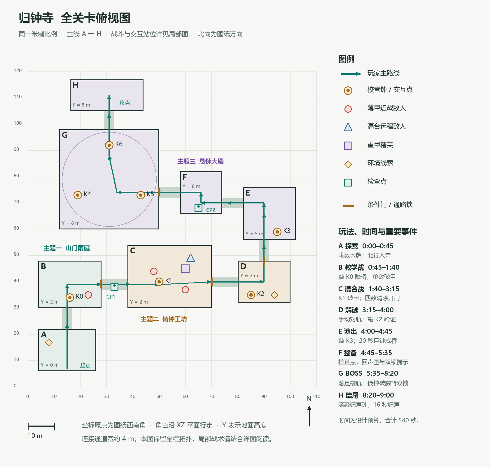

# 归钟寺 · 最后一响

第三人称动作关卡原型，版本 0.6.1。关卡以钟声串联探索、铸钟工坊机关和首领战。玩家先学会读取并操作机关，再利用首领重踏后的窗口敲钟，依次攻击前后锁芯。

- [关卡设计方案](01_设计文档/关卡设计方案.md)和[关卡节奏图](01_设计文档/关卡节奏图.png)
- [20 页关卡设计演示](归钟寺_关卡设计演示_0.6.1.pptx)
- [实机演出选段](归钟寺_实机演出预览.mp4)
- [下载 Windows 试玩及 Unity 工程](https://github.com/gearsofwarhao-0703/game-design-portfolio/releases/download/portfolio-v1/gui-zhong-temple.zip)

解压后打开 `开始阅读.html` 查看离线导航，双击 `启动试玩.cmd` 进入试玩。Unity 6000.6.2f1 工程位于 `06_Unity工程/GuiZhongTemple`，入口场景为 `Assets/Scenes/TempleGraybox.unity`。
