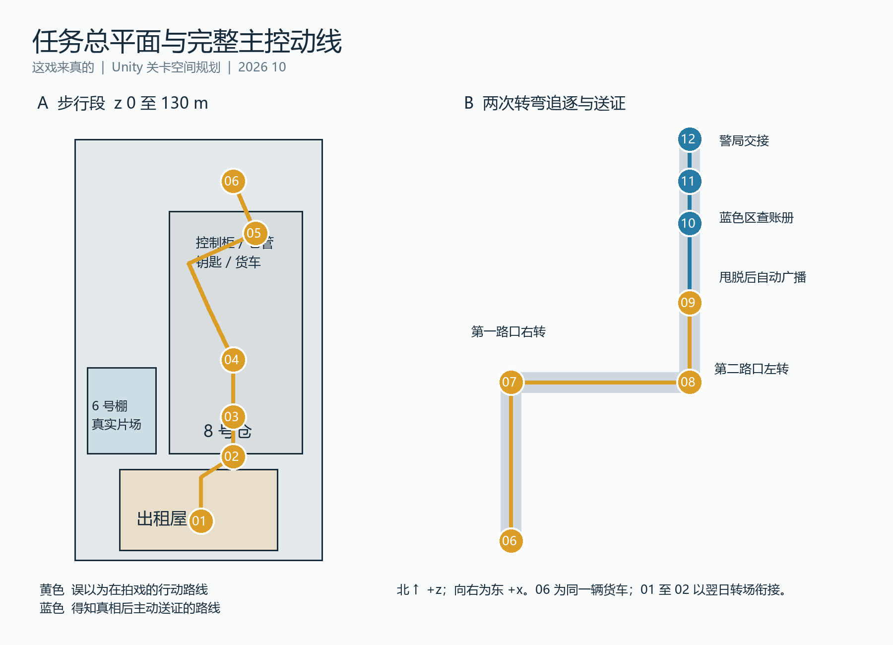

# 这戏来真的

第三人称叙事任务原型，版本 1.7。主线由出租屋调查与接取任务、仓库过场和三波战斗、驾驶追逐、账册调查以及警局交接组成。主菜单还可直接进入过场、战斗教学或追逐章节。

- [任务设计、叙事关卡设计及动画分镜](01_设计文档/)
- [场景平面及动线规划](02_场景规划/)
- [误入八号仓实机过场](02_误入八号仓过场.mp4)
- [下载七段实机视频、Windows 试玩及 Unity 工程](https://github.com/gearsofwarhao-0703/game-design-portfolio/releases/download/portfolio-v1/real-take.zip)

解压后双击 `启动试玩.cmd`，在主菜单选择完整任务或章节。Unity 6000.6.2f1 工程位于 `05_Unity工程/RealTake`，入口场景为 `Assets/Scenes/Main.unity`。
